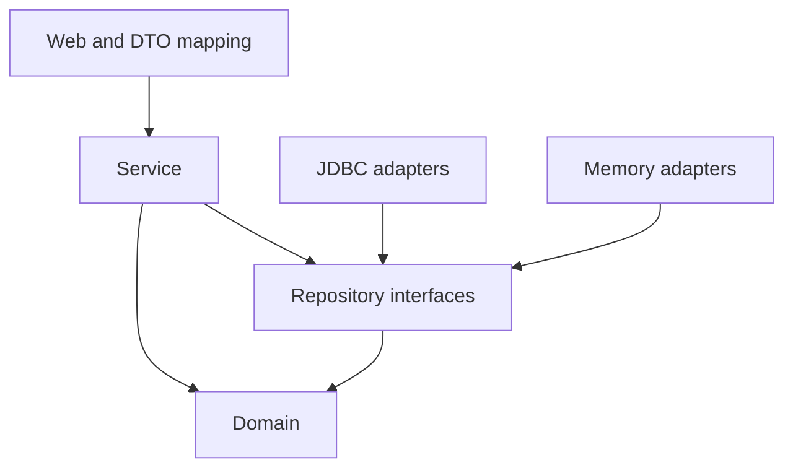

# Architecture

## 1. Packages

`web`: HTTP and hand-written DTO mapping; `web.dto`: transport records; `service`: catalog use cases; `repository`: persistence contracts; `repository.jdbc`: JdbcClient adapters; `repository.memory`: student/enrollment adapters; `domain`: framework-free records; `config`: bean wiring; `support`: application exceptions.

## 2. Dependency rules

Five ArchUnit rules execute with Maven tests: independent domain, no HTTP/SQL/concrete adapters in services, no upper-layer dependencies in repositories, no repository/SQL dependencies in web, and independent DTOs.

## 3. Layer direction

Text equivalent: web calls service; service calls repository interfaces. JDBC and memory adapters implement those interfaces. Domain records represent data without depending on higher layers. Configuration selects adapters. Mapping lives at the web boundary because DTOs belong to HTTP; moving it into services would introduce a transport dependency into business logic. JdbcClient stays in JDBC adapters so services do not change when the database changes.
